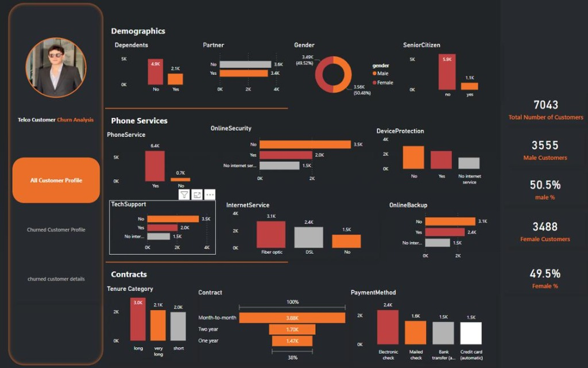
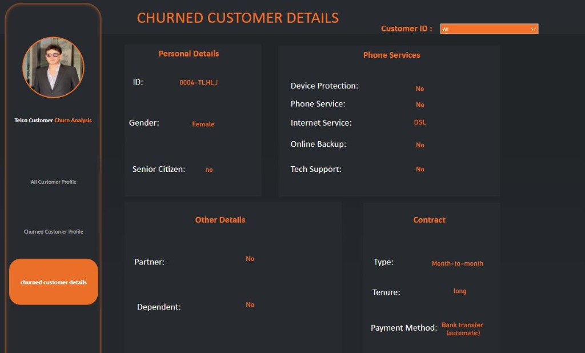

# Telco Customer Churn Analysis — Python & Power BI

An end-to-end **Customer Churn Analysis & Retention Intelligence** project for a telecom company, combining **Python** (data preprocessing, feature engineering, and predictive modeling) with an interactive, multi-page **Power BI** dashboard.

---

## 🎯 Project Overview

- **Dataset Scale:** `7,043` telecom customers (`3,555` Male / `50.5%`, `3,488` Female / `49.5%`)
- **Objective:** Identify the key demographic, service, and contract factors driving customer attrition and equip retention teams with actionable, customer-level insights.

---

## ⚙️ Methodology

1. **Data Preprocessing & Feature Engineering (Python):**
   - Cleaned missing values, encoded categorical features, and engineered **Tenure Categories** (`short`, `long`, `very long`).
   - Built predictive churn models to surface high-risk customer segments.
2. **Interactive BI Dashboard (Power BI):**
   - **All Customer Profile:** High-level KPIs alongside breakdowns of Demographics (`Dependents`, `Partner`, `Gender`, `SeniorCitizen`), Phone & Internet Services (`PhoneService`, `OnlineSecurity`, `DeviceProtection`, `TechSupport`, `InternetService`, `OnlineBackup`), and Contracts (`Tenure Category`, `Contract Type`, `PaymentMethod`).
   - **Churned Customer Profile:** Focused view of attrition patterns across contract types (e.g., Month-to-month vs. 1-year / 2-year) and payment methods.
   - **Churned Customer Details:** Individual Customer ID drill-through (e.g., `0004-TLHLJ`) displaying personal details, subscribed services, and contract metadata.

---

## 📸 Dashboard Screenshots

### 1. All Customer Profile (7,043 Customers)

### 2. Churned Customer Details (Customer ID Drill-Through)

---

## 🛠️ Tech Stack

- **Data Science & Modeling:** Python (Pandas, Scikit-learn)
- **BI & Visualization:** Microsoft Power BI (DAX, Power Query, Multi-page Navigation & Drill-through)
